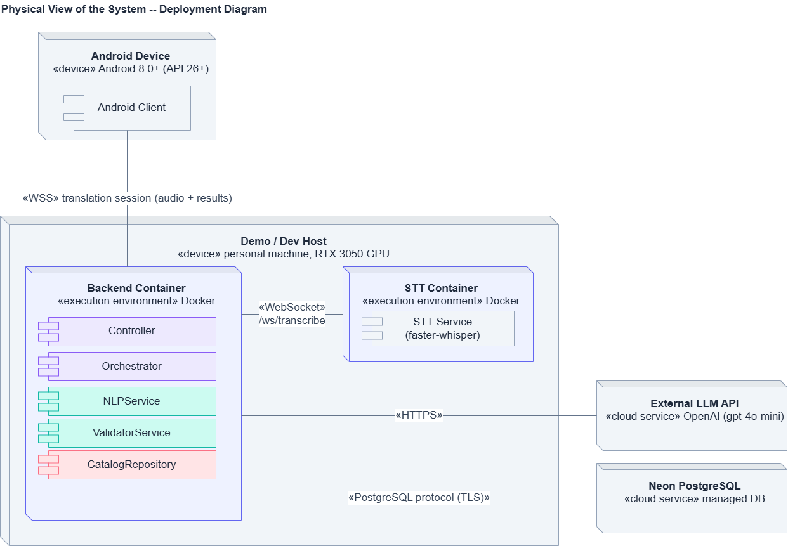
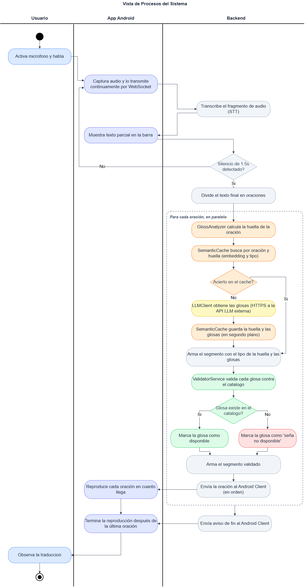
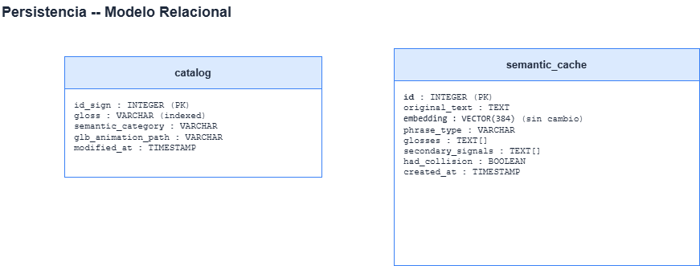

# Descripción del Diseño del Software (SDD) — SignAI

**Pontificia Universidad Javeriana**
**Fecha del documento:** 30 de agosto de 2026

---

## 1. Historial de Cambios

| Fecha | Descripción del cambio | Persona(s) |
|---|---|---|
| 19/08/2026 | Migración de plantilla institucional a formato LaTeX para su edición en Overleaf. | Julián Ramos |
| 20/10/2026 | Alineación del diseño con el backend implementado: segmentación de la frase en oraciones y traducción en paralelo, un solo canal WebSocket, animaciones incluidas en la aplicación, estado *Texto listo* en la interfaz, y sección de instrumentación. | Juan Diego Muñoz Angulo |

---

## 2. Tabla de Contenidos

1. Historial de Cambios
2. Tabla de Contenidos
3. Lista de Figuras
4. Lista de Tablas
5. Introducción
6. Arquitectura
   6.1. Vista Lógica del Sistema
   6.2. Vista Física del Sistema
   6.3. Vista de Procesos del Sistema
7. Diseño Detallado
   7.1. Estructura del Sistema
   7.2. Comportamiento del Sistema
   7.3. Persistencia
   7.4. Interfaz de Usuario
   7.5. Instrumentación
8. Modelo C4
   8.1. Contexto
   8.2. Contenedores
   8.3. Componentes
9. Referencias

---

## 3. Lista de Figuras

1. Diagrama de componentes de la Vista Lógica del Sistema — `diagrams/sdd-6.1-vista-logica-componentes.drawio.png`
2. Diagrama de despliegue de la Vista Física del Sistema — `diagrams/sdd-6.2-vista-fisica-despliegue.drawio.png`
3. Diagrama de actividades de la Vista de Procesos del Sistema — `diagrams/sdd-6.3-vista-procesos-actividades.drawio.png`
4. Diagrama de clases de Orquestación — `diagrams/sdd-7.1-clases-1-orquestacion.drawio.png`
5. Diagrama de clases de NLP — `diagrams/sdd-7.1-clases-2-nlp.drawio.png`
6. Diagrama de clases de Validación y Catálogo — `diagrams/sdd-7.1-clases-3-validacion-catalogo.drawio.png`
7. Diagrama de secuencia del flujo de traducción — `diagrams/sdd-7.2-secuencia-flujo-traduccion.drawio.png`
8. Modelo relacional de persistencia — `diagrams/sdd-7.3-persistencia-relacional.drawio.png`
9. Diagrama de estados de la interfaz de usuario — `diagrams/sdd-7.4-diagrama-estados-ui.drawio.png`
10. Diagrama de contexto del sistema (C4 Nivel 1) — `diagrams/sdd-c4-1-contexto.drawio.png`
11. Diagrama de contenedores del sistema (C4 Nivel 2) — `diagrams/sdd-c4-2-contenedores.drawio.png`
12. Diagrama de componentes del Backend (C4 Nivel 3) — `diagrams/sdd-c4-3-componentes-backend.drawio.png`

## 4. Lista de Tablas

*(El documento original no incluye tablas de contenido de datos adicionales fuera de la de Historial de Cambios.)*

---

## 5. Introducción

Este documento describe el diseño de software de SignAI, un sistema que traduce audio en español a Lengua de Señas Colombiana mediante inteligencia artificial y lo reproduce a través de un avatar 3D. Presenta la arquitectura del sistema en tres vistas complementarias (lógica, física y de procesos), la profundiza bajo el modelo C4 en sus tres niveles de abstracción (contexto, contenedores y componentes), y desarrolla el diseño detallado del backend: la estructura de sus clases, el comportamiento del flujo de traducción, el modelo de persistencia de datos y los estados de la interfaz de usuario.

Este documento está dirigido a quienes implementan y mantienen SignAI, así como a quienes evalúan el proyecto en su desarrollo académico. Su propósito es servir como referencia técnica de las decisiones de diseño detrás de cada componente del sistema, de modo que cualquier persona que se incorpore al proyecto pueda entender cómo está construido.

---

## 6. Arquitectura

La arquitectura de SignAI se describe en tres vistas complementarias. La Vista Lógica muestra los componentes de software del backend y las interfaces por las que se comunican entre sí. La Vista Física muestra en qué máquinas y contenedores corre cada uno de esos componentes. La Vista de Procesos muestra el flujo completo de una traducción, desde que el usuario activa el micrófono hasta que ve la seña ejecutada por el avatar.

### 6.1. Vista Lógica del Sistema

Para la Vista Lógica del Sistema se usa un diagrama de componentes, ya que permite mostrar los módulos principales del backend y las interfaces que los conectan entre sí, sin entrar todavía en detalles de implementación ni de despliegue físico.

**Figura 1: Diagrama de componentes de la Vista Lógica del Sistema**

En el diagrama, el backend está organizado como un monolito, con el Servicio STT como único componente que corre en un proceso aparte, debido a su consumo de GPU y VRAM.

El Controller recibe la conexión WebSocket del cliente Android y se comunica con el Servicio STT para transcribir el audio. La transcripción se devuelve a la aplicación tal cual, sin traducir: es el cliente quien decide qué texto se traduce y lo reenvía como una frase. Cuando el Controller recibe ese texto, se lo entrega al Orchestrator, que es quien conoce la secuencia del proceso de traducción: primero divide la frase en oraciones y llama a NLPService, y después llama a ValidatorService.

NLPService depende de la extensión pgvector de PostgreSQL para buscar coincidencias semánticas en el caché, y de la API del LLM externo cuando no encuentra ninguna. Sus colaboradores internos (el divisor de oraciones, el analizador de huella gramatical, el caché semántico y el cliente del LLM) no se muestran aquí, porque corresponden al diagrama de clases de la sección 7.1.

ValidatorService solo se comunica con CatalogRepository, que es el único componente con acceso a las tablas del catálogo en PostgreSQL.

Por último, el cliente Android no le pide al servidor los archivos de animación: los 50 archivos GLB van dentro de la propia aplicación.

### 6.2. Vista Física del Sistema

Para la Vista Física del Sistema se usa un diagrama de despliegue, ya que permite mostrar en qué máquinas y contenedores corre cada componente, y qué protocolo de comunicación usa cada conexión entre ellos.

**Figura 2: Diagrama de despliegue de la Vista Física del Sistema**

Elementos del diagrama:
- **Android Device** («device», Android 8.0+ / API 26+) contiene el **Android Client**.
  - Canal `«WSS» translation session (audio + results)` hacia el Backend. Los archivos de animación GLB van dentro del APK, así que no hay ningún canal aparte para descargarlos.
- **Demo / Dev Host** («device», máquina personal con GPU RTX 3050), que contiene dos contenedores Docker:
  - **Backend Container** («execution environment» Docker): Controller, Orchestrator, NLPService, ValidatorService, CatalogRepository.
  - **STT Container** («execution environment» Docker): STT Service (faster-whisper). Protocolo entre Backend y STT: WebSocket en `/ws/transcribe`.
- Servicios en la nube:
  - **External LLM API** («cloud service», pay-per-use, OpenAI `gpt-4o-mini`), conectado desde el Backend por HTTPS.
  - **Neon PostgreSQL** («cloud service», managed DB), conectado desde el Backend mediante protocolo PostgreSQL sobre TLS.

El cliente Android corre en el dispositivo del usuario (Android 8.0 o superior) y se comunica con el backend por un único canal: el WebSocket, que transporta tanto el audio como los resultados de la traducción. Las animaciones de las 50 señas van incluidas en el propio APK, de modo que el cliente no necesita pedirlas al servidor.

El backend corre en un mismo equipo físico, una máquina personal, dividido en dos contenedores Docker: el contenedor del backend, que agrupa Controller, Orchestrator, NLPService, ValidatorService y CatalogRepository, y el contenedor del Servicio STT, que corre aparte por su consumo de GPU y VRAM.

El backend se comunica además con dos servicios en la nube: la API del LLM externo, por HTTPS, y Neon PostgreSQL, mediante el protocolo nativo de PostgreSQL sobre TLS.

### 6.3. Vista de Procesos del Sistema

Para la Vista de Procesos del Sistema se usa un diagrama de actividades, ya que la aplicación tiene un único flujo de interacción de punta a punta, sin variantes de proceso que ameriten varios diagramas.

**Figura 3: Diagrama de actividades de la Vista de Procesos del Sistema**

El flujo se divide en tres carriles: Usuario, App Android y Backend.

1. El usuario activa el micrófono y habla.
2. La app captura el audio y lo transmite continuamente por WebSocket.
3. El backend transcribe los fragmentos de audio (STT) y la app muestra el texto parcial en pantalla.
4. Al detectar 1.5 segundos de silencio, el backend recibe el texto final y lo divide en oraciones.
5. **Para cada oración, y todas en paralelo:**
   - `GlossAnalyzer` calcula la huella gramatical (*fingerprint*) de la oración.
   - `SemanticCache` busca una coincidencia por la oración y la huella (embedding y tipo).
     - Si hay acierto (**cache hit**): se reutiliza el resultado guardado.
     - Si no (**cache miss**): `LLMClient` obtiene las glosas desde el LLM externo (HTTPS) y `SemanticCache` guarda la huella junto con las glosas para futuras búsquedas, en segundo plano.
   - En ambos casos, el tipo de frase del segmento siempre proviene de la huella calculada localmente, **nunca del LLM**.
   - Se arma el segmento con el tipo de la huella y las glosas.
   - `ValidatorService` valida cada glosa contra el catálogo:
     - Si la glosa existe: resuelve la ruta de animación GLB.
     - Si no existe: marca la glosa como "seña no disponible".
   - Se arma el segmento validado y se envía al Android Client, con su número de posición y el total de oraciones. Las oraciones se entregan **en orden**, aunque se hayan traducido en paralelo.
6. El Android Client reproduce cada oración en cuanto llega, y cuando ya salió la última recibe el aviso de fin y termina la reproducción.

---

## 7. Diseño Detallado

El diseño detallado de SignAI se describe en cuatro subsecciones. La **Estructura del Sistema** presenta las clases del backend y sus relaciones. El **Comportamiento del Sistema** muestra, mediante un diagrama de secuencia, cómo colaboran esas clases a lo largo de una traducción completa. La **Persistencia** describe las tablas que el sistema usa para guardar el catálogo de señas y el caché semántico. Por su parte, la **Interfaz de Usuario** describe los estados por los que pasa la pantalla única de la aplicación.

### 7.1. Estructura del Sistema

La estructura interna del backend se presenta en tres diagramas de clases: orquestación, NLP, y validación con catálogo. Las clases que ya aparecen detalladas en otro diagrama se muestran aquí como referencia, con una nota que indica dónde se desarrollan por completo.

#### Diagrama de Clases — Orquestación (Controller y Orchestrator)

**Figura 4: Diagrama de clases de Orquestación**

Clases y elementos principales:
- **Controller**
  - Atributos: `orchestrator: Orchestrator`, `sttClient: SttServiceClient`
  - Métodos:
    - `+ handleAudioChunk(chunk: ByteArray): void`
    - `+ handleText(text: String): void`
    - `+ handleEnd(): void`
    - `+ handleTranscript(text: String, isFinal: Boolean): void`
    - `+ sendTranscript(text: String, isFinal: Boolean): void`
    - `+ sendSegment(index: Int, total: Int, segment: ValidatedSegment): void`
    - `+ sendError(message: String): void`
- **«interface» SttServiceClient** (detalle completo fuera de este diagrama)
- **Orchestrator**
  - Atributos: `nlpService: NLPService`, `validatorService: ValidatorService`
  - Métodos: `+ translate(text: String): List<ValidatedSegment>`, `+ translateStream(text: String): AsyncIterator<(index, total, segment)>`
- **«interface» NLPService** — `+ transform(text: String): List<Segment>`, `+ split(text: String): List<String>`, `+ transformSentence(sentence: String): Segment` (detalle completo en el Diagrama de NLP)
- **«interface» ValidatorService** — `+ validate(segments: List<Segment>): List<ValidatedSegment>` (detalle completo en el diagrama de Validación y Catálogo)
- **ValidatedSegment** (detalle completo en diagrama de NLP)

Controller mantiene una referencia a `Orchestrator` y a `SttServiceClient`, y expone tres métodos de entrada: `handleAudioChunk(chunk)` recibe cada fragmento de audio que llega del cliente Android y lo reenvía a `SttServiceClient`; `handleText(text)` recibe el texto que hay que traducir y lo entrega a Orchestrator; y `handleEnd()` reenvía al servicio de STT la señal de fin de captura, para que cierre el tramo de audio en curso. La transcripción que vuelve del servicio de STT llega a `handleTranscript(text, isFinal)`, que la reenvía a la aplicación sin traducirla, porque el cliente es quien decide qué texto se traduce. Hacia el cliente, Controller emite `sendTranscript(text, isFinal)`, `sendSegment(index, total, segment)` y `sendError(message)`. El único disparador de la traducción es `handleText`: cuando el texto llega por el canal de traducción, Controller lo entrega a Orchestrator a través de `translateStream(text)`.

Orchestrator mantiene referencias a `NLPService` y `ValidatorService`, ambas como interfaces en vez de implementaciones concretas. Su método público `translateStream(text)` divide la frase en oraciones con `NLPService.split(text)` y lanza la traducción de todas a la vez, de forma concurrente, con `NLPService.transformSentence(sentence)`; después las va entregando a Controller en el orden en que aparecen dentro de la frase, con su número de posición y el total de oraciones. Cada oración se valida por separado con `ValidatorService.validate([segment])`, y el resultado, un `ValidatedSegment`, es lo que se devuelve. La estructura de `ValidatedSegment` se desarrolla más adelante en esta misma sección.

Dentro de NLPService, la transformación de texto a glosas involucra varias entidades, las cuales se detallan en el siguiente diagrama.

#### Diagrama de Clases — NLP

**Figura 5: Diagrama de clases de NLP**

Clases y elementos principales:
- **NLPServiceImpl** implementa `NLPService`
  - Atributos: `analyzer: GlossAnalyzer`, `cache: SemanticCache`, `llmClient: LLMClient`
  - Método: `+ transform(text: String): List<Segment>`
- **GlossAnalyzer**
  - `+ analyze(text: String): Fingerprint`
- **SemanticCache**
  - `+ lookup(text: String, fingerprint: Fingerprint): List<Segment>?`
  - `+ store(text: String, fingerprint: Fingerprint, segments: List<Segment>): void`
- **LLMClient**
  - Atributos: `model: String`, `temperature: Double`, `timeoutMs: Int`
  - `+ transform(text: String): List<String>`
  - Se apoya en **External LLM API** y en **PostgreSQL (pgvector)** (para `SemanticCache`)
- **Fingerprint**
  - Atributos: `category: PhraseType`, `secondarySignals: List<PhraseType>`, `hasCollision: Boolean`
- **PhraseType** (enum): `AFFIRMATIVE`, `YES_NO_QUESTION`, `CONTENT_QUESTION`, `NEGATIVE`, `IMPERATIVE`
- **Segment**
  - Atributos: `type: PhraseType`, `glosses: List<String>`

`NLPServiceImpl` implementa la interfaz `NLPService` apoyándose en cuatro colaboradores, referenciados como atributos: `segmenter` (`SentenceSegmenter`), `analyzer` (`GlossAnalyzer`), `cache` (`SemanticCache`) y `llmClient` (`LLMClient`). `SentenceSegmenter` expone un único método, `segment(text)`, que divide una frase en oraciones. `GlossAnalyzer` expone un único método, `analyze(text)`, que calcula la huella gramatical del texto y la devuelve como un objeto `Fingerprint`, con tres atributos: `category` (el tipo de frase que determinan las reglas gramaticales), `secondarySignals` (otras señales de tipo detectadas en el mismo texto) y `hasCollision` (si hubo más de una señal en conflicto).

Con esa huella calculada, `NLPServiceImpl` llama a `SemanticCache.lookup(text, fingerprint)`, que busca una traducción ya resuelta comparando tanto el embedding del texto como el tipo de frase de la huella. Si no hay coincidencia, se invoca `LLMClient.transform(text)`, cuyos atributos (`model`, `temperature`, `timeoutMs`) configuran la llamada al modelo de lenguaje externo; su responsabilidad se limita a devolver la lista de glosas, sin opinar sobre el tipo de frase. El resultado se guarda con `SemanticCache.store(text, fingerprint, glosses)` para futuras búsquedas, y ese guardado se hace en segundo plano, para que la respuesta al cliente no espere a que termine la escritura en la base de datos. En cualquiera de los dos caminos, `NLPServiceImpl` arma cada `Segment` con `buildSegment(fingerprint, glosses)`, de modo que el tipo de frase siempre proviene de la huella calculada por `GlossAnalyzer`, **nunca del LLM**. `Segment` queda entonces compuesto por `type` (`PhraseType`) y `glosses` (la lista de texto plano de las glosas), y `PhraseType` enumera las cinco categorías posibles: afirmativa, interrogativa de sí o no, interrogativa de contenido, negativa e imperativa.

La validación de esas glosas contra el catálogo, y la resolución de sus rutas de animación, se muestran en el tercer diagrama.

#### Diagrama de Clases — Validación y Catálogo

**Figura 6: Diagrama de clases de Validación y Catálogo**

Clases y elementos principales:
- **ValidatorServiceImpl** implementa `ValidatorService`
  - `+ validate(segments: List<Segment>): List<ValidatedSegment>`
  - Atributo: `catalogRepository: CatalogRepository`
- **CatalogRepository**
  - Atributo: `cache: Map<String, CatalogEntry>`
  - `+ loadAll(): void`
  - `+ search(gloss: String): CatalogEntry?`
- **CatalogEntry**
  - Atributos: `gloss: String`, `glbPath: String`
- **Gloss**
  - Atributos: `text: String`, `available: Boolean`, `glbPath: String`
- **PhraseType** (referenciado desde el diagrama de NLP)
- **ValidatedSegment**
  - Atributos: `type: PhraseType`, `glosses: List<Gloss>`

`ValidatorServiceImpl` implementa la interfaz `ValidatorService` y depende de `CatalogRepository`, al que mantiene como atributo. Su único método, `validate(segments)`, recorre las glosas de cada segmento y, por cada una, llama a `CatalogRepository.search(gloss)`. `CatalogRepository` mantiene en memoria un mapa (`cache`, de tipo `Map<String, CatalogEntry>`) que se carga una sola vez con `loadAll()` al arrancar el backend; a partir de ahí, `search(gloss)` resuelve las búsquedas contra ese mapa en memoria en lugar de consultar PostgreSQL en cada solicitud. Cada `CatalogEntry` tiene dos atributos, `gloss` y `glbPath`.

Con esa información, `ValidatorServiceImpl` construye un objeto `Gloss` por cada glosa, con tres atributos: `text`, `available` (si la glosa existe en el catálogo) y `glbPath` (la ruta de su animación, vacía si no está disponible). El resultado se agrupa en `ValidatedSegment`, que conserva el `type` del segmento original junto con la lista de `glosses`, ahora ya resueltas, y es esa lista de `ValidatedSegment` la que finalmente recibe Orchestrator.

### 7.2. Comportamiento del Sistema

El comportamiento del sistema se documenta en un único diagrama de secuencia, que cubre el flujo completo de una traducción: desde que el cliente envía el texto que hay que traducir hasta que el backend manda la última oración y el aviso de fin de la traducción.

**Figura 7: Diagrama de secuencia del flujo de traducción**

Participantes: `Android Client`, `Controller`, `Orchestrator`, `NLPServiceImpl`, `SentenceSegmenter`, `GlossAnalyzer`, `SemanticCache`, `LLMClient`, `ValidatorServiceImpl`, `CatalogRepository`.

Secuencia (los 23 pasos numerados en el diagrama):

1. `Android Client` → `Controller`: el audio por el WebSocket.
2. `Controller` → `Orchestrator`: `translateStream(text)`.
3. `Orchestrator` → `NLPServiceImpl`: `split(text)`.
4. `NLPServiceImpl` → `SentenceSegmenter`: `segment(text)`.
5. `SentenceSegmenter` devuelve la `List<String>` de oraciones.
6. `NLPServiceImpl` devuelve esa lista a `Orchestrator`.
7. `Orchestrator` → `NLPServiceImpl`: `transformSentence(sentence)`, y así para cada oración, todas en paralelo.
8. `NLPServiceImpl` → `GlossAnalyzer`: `analyze(sentence)`.
9. `GlossAnalyzer` devuelve el `Fingerprint`.
10. `NLPServiceImpl` → `SemanticCache`: `lookup(sentence, fingerprint)`.
11. `SemanticCache` devuelve las glosas o `null`.
    - **Fase NLP — cache hit:** `NLPServiceImpl` reutiliza las glosas devueltas, sin llamar al LLM.
    - **Fase NLP — cache miss:**
      12. `NLPServiceImpl` → `LLMClient`: `transform(sentence)` (HTTPS a la API del LLM externo).
      13. `LLMClient` devuelve `glosses`.
      14. `NLPServiceImpl` → `SemanticCache`: `store(sentence, fingerprint, glosses)`, en segundo plano: no se espera la respuesta.
15. `NLPServiceImpl` arma el `Segment` con `buildSegment(fingerprint, glosses)`.
16. `NLPServiceImpl` devuelve el `Segment` a `Orchestrator`.
17. `Orchestrator` → `ValidatorServiceImpl`: `validate([segment])` — **Fase Validación**.
    - Para cada glosa del segmento:
      18. `ValidatorServiceImpl` → `CatalogRepository`: `search(gloss)`.
      19. `CatalogRepository` devuelve `CatalogEntry` o `null`.
        - Si existe: arma `Gloss(available=true, glbPath=...)`.
        - Si no existe: arma `Gloss(available=false)`.
20. `ValidatorServiceImpl` devuelve el `ValidatedSegment` a `Orchestrator`.
21. **En el orden de las oraciones:** `Orchestrator` → `Controller`: `(index, total, ValidatedSegment)`.
22. `Controller` → `Android Client`: el frame `segment`, con la oración traducida.
23. `Controller` → `Android Client`: el frame `done`, cuando ya salió la última oración.

Controller entrega el texto a Orchestrator mediante `translateStream(text)`, que divide la frase en oraciones con `NLPService.split(text)` y lanza la traducción de todas a la vez, de forma concurrente. Cada oración se traduce por separado: `NLPServiceImpl` invoca primero `GlossAnalyzer.analyze(sentence)`, el cual devuelve la huella gramatical de esa oración. Con esa huella, llama a `SemanticCache.lookup(sentence, fingerprint)`, que compara tanto el embedding de la oración como el tipo de frase de la huella contra lo ya guardado.

Si hay acierto en el caché, `NLPServiceImpl` reutiliza directamente las glosas devueltas. Si no lo hay, invoca `LLMClient.transform(sentence)`, que hace la llamada HTTPS al LLM externo y devuelve la lista de glosas, y guarda ese resultado con `SemanticCache.store(sentence, fingerprint, glosses)` para futuras búsquedas, en segundo plano. En cualquiera de los dos caminos, `NLPServiceImpl` arma el segmento con `buildSegment(fingerprint, glosses)`, tomando el tipo de frase según la huella, y devuelve el `Segment`.

Orchestrator valida ese segmento con `ValidatorService.validate([segment])`. `ValidatorServiceImpl` recorre cada glosa del segmento y, por cada una, llama a `CatalogRepository.search(gloss)`. Cuando la glosa existe en el catálogo, arma un `Gloss` con `available=true` y la ruta de su animación; cuando no existe, lo arma con `available=false`. Terminado el recorrido, `ValidatorServiceImpl` devuelve el `ValidatedSegment` a Orchestrator.

Orchestrator entrega entonces ese segmento a Controller, que lo envía al cliente con `sendSegment(index, total, segment)`. Las oraciones se entregan en el orden en que aparecen dentro de la frase, aunque se hayan traducido en paralelo, y cada una viaja con su número de posición y el total de oraciones. Cuando ya salió la última, Controller envía el aviso de fin de la traducción.

Antes de que arranque esta secuencia, `CatalogRepository` ya ejecutó `loadAll()` al iniciar el backend, por lo que las búsquedas de `search(gloss)` se resuelven contra el catálogo en memoria, sin consultar PostgreSQL en cada solicitud.

### 7.3. Persistencia

La persistencia del sistema se documenta con un diagrama relacional, ya que las dos tablas que maneja el backend no tienen relaciones entre sí y su estructura se describe mejor con columnas y tipos de dato concretos que con un modelo entidad-relación.

**Figura 8: Modelo relacional de persistencia**

**Tabla `catalog`**

| Columna | Tipo | Notas |
|---|---|---|
| `id_sign` | INTEGER (PK) | Llave primaria entera autoincremental, independiente del contenido de la fila |
| `gloss` | VARCHAR (indexed) | Indexado; es el valor por el que `CatalogRepository` busca en cada validación. **No es único:** el mapa en memoria se construye con la glosa normalizada, así que dos filas que se normalicen al mismo valor dejan una sola entrada y el sistema se queda con la última sin avisar |
| `semantic_category` | VARCHAR | Clasifica la seña dentro del corpus |
| `glb_animation_path` | VARCHAR | Clave con la que la aplicación encuentra la animación entre las que trae dentro de sí; no es una dirección en la red. La usa `ValidatorServiceImpl` para construir cada `Gloss` |
| `modified_at` | TIMESTAMP | Registra cuándo se modificó por última vez cada entrada. El backend no lo consulta: el catálogo se carga en memoria al arrancar |

**Tabla `semantic_cache`**

| Columna | Tipo | Notas |
|---|---|---|
| `id` | INTEGER (PK) | Llave primaria |
| `original_text` | TEXT | La oración tal como llegó |
| `embedding` | VECTOR(384) | Representación vectorial calculada por un modelo de embeddings local; pgvector como motor de comparación por similitud |
| `phrase_type` | VARCHAR | Mismo valor que `Fingerprint.category`; junto con `embedding` es lo que `SemanticCache` compara en cada búsqueda |
| `glosses` | TEXT[] | Lista de glosas de la traducción |
| `secondary_signals` | TEXT[] | Qué otras señales de tipo detectó `GlossAnalyzer` en el mismo texto |
| `had_collision` | BOOLEAN | Si hubo alguna colisión entre señales — pensado para medir con datos reales qué tan seguido ocurre ese caso |
| `created_at` | TIMESTAMP | Cuándo se guardó cada entrada |

La tabla `catalog` guarda las 50 glosas del corpus, con `id_sign` como llave primaria: un entero autoincremental, independiente del contenido de la fila, de modo que la identidad de un registro no cambia cuando se corrige su glosa o su ruta de animación. El campo `gloss` está indexado, ya que es el valor por el que `CatalogRepository` busca en cada solicitud de validación, pero no es único. El mapa en memoria se construye con la glosa normalizada, de modo que dos filas que se normalicen al mismo valor (la misma glosa, o la misma con y sin tilde) dejan una sola entrada en el mapa, y el sistema se queda con la última sin avisar: por eso el catálogo se mantiene sin glosas repetidas. `semantic_category` clasifica la seña dentro del corpus, y `glb_animation_path` no es una dirección en la red: es la clave con la que la aplicación encuentra el archivo de animación entre los que trae dentro de sí, y `ValidatorServiceImpl` la usa para construir cada `Gloss`. (TODO: acordar con el equipo el formato exacto de esa clave: hoy el catálogo guarda rutas como `/static/glb/casa.glb`, pensadas para un servidor de archivos que ya no existe.) `modified_at` registra cuándo se modificó por última vez cada entrada. El backend no consulta ese campo: el catálogo se carga en memoria al arrancar el servicio, de modo que un cambio hecho en la base se reconoce la siguiente vez que el backend se reinicia.

La tabla `semantic_cache` guarda las traducciones que `SemanticCache` ya resolvió, con `id` como llave primaria. `original_text` conserva la oración tal como llegó, y `embedding` guarda su representación vectorial, calculada por un modelo de embeddings local, con la extensión pgvector de PostgreSQL como motor de comparación por similitud. `phrase_type` es el mismo valor que `Fingerprint.category`, y junto con `embedding` es lo que `SemanticCache` compara en cada búsqueda. `glosses` guarda la lista de glosas de la traducción, mientras que `secondary_signals` y `had_collision` registran, respectivamente, qué otras señales de tipo detectó `GlossAnalyzer` en el mismo texto y si hubo alguna colisión entre ellas, información pensada para medir con datos reales qué tan seguido ocurre ese caso. `created_at` registra cuándo se guardó cada entrada.

### 7.4. Interfaz de Usuario

La aplicación tiene una única pantalla, sin navegación entre vistas, por lo que la interfaz de usuario se documenta con un diagrama de estados en vez de uno de navegación. Cada estado representa lo que la pantalla muestra en un momento dado.

**Figura 9: Diagrama de estados de la interfaz de usuario**

Estados: `Inactivo`, `Grabando`, `Texto listo`, `Procesando`, `Reproduciendo`, `Error`, `Desconectado`.

Transiciones principales:
- `Inactivo` → (activa micrófono) → `Grabando`
- `Grabando` → (detiene grabación / silencio detectado) → `Texto listo`
- `Grabando` → (modo TR: envía la frase) → `Procesando`
- `Texto listo` → (cancela) → `Inactivo`
- `Texto listo` → (confirma el envío) → `Procesando`
- `Procesando` → (resultado recibido) → `Reproduciendo`
- `Procesando` → (error en STT/NLP/LLM) → `Error`
- `Error` → (automático) → `Inactivo`
- `Reproduciendo` → (animación termina) → `Inactivo`
- `Reproduciendo` → (pierde conexión WebSocket) → `Desconectado`
- `Desconectado` → (reconecta automático) → `Inactivo`

La pantalla inicia en `Inactivo`, con el micrófono apagado. Al activarlo, pasa a `Grabando`, y se mantiene ahí capturando audio hasta que el usuario detiene la grabación o el sistema detecta silencio, momento en el que pasa a `Texto listo`, con la transcripción final a la vista. Desde ese estado, el usuario puede confirmar el envío, pasando a `Procesando`, o cancelar y volver directamente a `Inactivo`. En el modo de traducción en tiempo real (TR) el micrófono sigue encendido, de modo que el estado `Texto listo` no aparece: cada frase se envía al detectarse la pausa y el indicador pasa directo a `Procesando`.

Durante `Procesando`, si el resultado llega correctamente, la pantalla pasa a `Reproduciendo`, donde el avatar ejecuta la traducción; si alguno de los servicios de backend falla, pasa a `Error`, del cual se vuelve a `Inactivo` de forma automática en tres segundos o menos.

Desde `Reproduciendo`, la pantalla vuelve a `Inactivo` cuando la animación termina. Si en cambio se pierde la conexión por WebSocket durante la reproducción, pasa a `Desconectado`, y regresa a `Inactivo` una vez el cliente logra reconectarse.

### 7.5. Instrumentación

El backend mide su propio comportamiento y lo publica en dos formatos, para que el equipo de pruebas pueda caracterizar el sistema sin instrumentar la aplicación. El punto de acceso `GET /metrics` devuelve las métricas en el formato de texto de Prometheus, y el punto de acceso `GET /metrics.json` devuelve las mismas métricas en formato JSON, junto con la configuración del servidor. Ninguno de los dos exige autenticación.

Las métricas que describen el tiempo de respuesta del pipeline son las que empiezan por `rt_`: `rt_first_sign_ms` mide, desde que el backend recibe la frase, el tiempo que tarda en enviar la primera oración traducida; `rt_phrase_total_ms`, el que tarda en enviar la última; y `rt_sentence_delay_ms`, el de cada oración por separado. El nombre de la primera se conservó a propósito aunque mida solo hasta el envío de la primera oración, porque es la cifra que el proyecto publica como línea base y así se puede comparar. Hay contadores de frases, oraciones, glosas y errores (`rt_phrases_total`, `rt_sentences_total`, `rt_glosses_total`, `rt_phrase_errors_total`), un histograma de cuántas oraciones tiene cada frase (`rt_phrase_sentences`), el trabajo ocupado por cada trama de audio leída (`rt_read_loop_busy_ms`), el tiempo de la llamada al modelo de lenguaje (`llm_ms`, con el nombre del modelo como etiqueta) y el de la consulta a la caché (`cache_lookup_ms`). El número de sesiones abiertas se publica como `sessions_active`.

Además de las métricas, cada frase deja una traza en memoria (`PipelineTrace`) que registra el tiempo que se pasó en cada paso del procesamiento: segmentación, huella gramatical, consulta a la caché, llamada al modelo de lenguaje, validación y total. Esa traza se escribe en el registro del servidor y, si la traza está activada, se envía además al cliente como un mensaje de tipo `trace`.

---

## 8. Modelo C4

Además de las vistas de arquitectura presentadas en la sección 6, el sistema se documenta bajo el modelo C4, el cual permite observarlo en tres niveles de abstracción progresivos: contexto, contenedores y componentes. Cada nivel abre la caja del anterior: el contexto muestra el sistema completo frente a sus usuarios y dependencias externas, sin ningún detalle interno; los contenedores exponen los bloques tecnológicos que lo conforman; y los componentes desglosan el contenedor del Backend para mostrar sus piezas internas y cómo se comunican entre sí.

### 8.1. Contexto

El diagrama de contexto muestra a SignAI como una sola caja, junto con las personas que interactúan con el sistema y los sistemas externos de los que depende, sin entrar en su arquitectura interna.

**Figura 10: Diagrama de contexto del sistema (C4 Nivel 1)**

El sistema tiene dos tipos de usuario. El **usuario oyente** activa el micrófono y habla en español, mientras que el **usuario sordo o usuario LSC** observa la traducción que el sistema ejecuta a través de su avatar 3D. Ambos interactúan desde la misma aplicación Android, en momentos distintos del flujo de traducción.

El único sistema externo del que depende SignAI es la **API del LLM externo**, a la que se envía el texto transcrito para transformarlo en glosas de Lengua de Señas Colombiana. PostgreSQL y el servicio de transcripción de voz no aparecen en este diagrama ya que, en este nivel de abstracción, se consideran parte del propio sistema y no un tercero del que dependa.

### 8.2. Contenedores

El diagrama de contenedores muestra los bloques tecnológicos que componen el sistema, junto con el protocolo de comunicación que usa cada conexión entre ellos.

**Figura 11: Diagrama de contenedores del sistema (C4 Nivel 2)**

El Android Client se comunica con el Backend por un único canal: el WebSocket, que transporta el audio y devuelve el resultado de la traducción. Los archivos de animación GLB van dentro de la aplicación, así que no hay ningún canal aparte para descargarlos.

El Backend, a su vez, se comunica con el STT Container para transcribir el audio y con PostgreSQL para leer y escribir el catálogo de señas y el caché semántico. Hacia afuera, envía el texto transcrito a la API del LLM externo para transformarlo en glosas.

El Backend y el STT Container corren en contenedores Docker separados, mientras que PostgreSQL es una instancia gestionada en Neon.

### 8.3. Componentes

El diagrama de componentes desglosa el Backend y muestra sus piezas internas, junto con las interfaces por las que cada una se comunica.

**Figura 12: Diagrama de componentes del Backend (C4 Nivel 3)**

El Controller recibe la conexión WebSocket del Android Client y se comunica con el STT Container para transcribir el audio. La transcripción se devuelve a la aplicación tal cual, sin traducir: es el cliente quien decide qué texto se traduce y lo reenvía como una frase. Cuando el Controller recibe ese texto, lo entrega al Orchestrator mediante `translateStream(text)`, que divide la frase en oraciones con `NLPService.split(text)` y las traduce por separado con `NLPService.transformSentence(sentence)`, validando cada una con `ValidatorService.validate([segment])`.

NLPService depende de PostgreSQL para las búsquedas por pgvector en el caché semántico, y de la API del LLM externo cuando no encuentra una coincidencia. ValidatorService solo se comunica con CatalogRepository, que a su vez consulta el catálogo en PostgreSQL.

Por fuera de este flujo, el Android Client no le pide nada al servidor: los archivos de animación GLB de las 50 señas van dentro de la propia aplicación.

---

## 9. Referencias

1. ISO/IEC/IEEE 42010.
2. IEEE Std 1016-2009.
3. RUP. *Software Architecture Document*. http://www.ts.mah.se/RUP/RationalUnifiedProcess/webtmpl/templates/a_and_d/rup_sad.htm
4. Philippe Kruchten, *Architectural Blueprints — The "4+1" View Model of Software Architecture*. http://www.cs.ubc.ca/~gregor/teaching/papers/4+1view-architecture.pdf
5. Scott Ambler, *UML Data Modeling Profile*. http://www.agiledata.org/essays/umlDataModelingProfile.html
6. Scott Ambler, *User Interface Flow Diagrams*. http://www.agilemodeling.com/artifacts/uiFlowDiagram.htm
